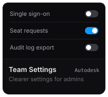
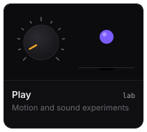
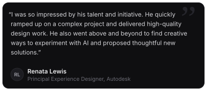
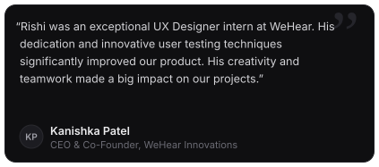

<a href="https://rishiashar.com">rishiashar.com</a> &nbsp;·&nbsp; <a href="https://www.linkedin.com/in/rishiashar7/">LinkedIn</a> &nbsp;·&nbsp; <a href="https://x.com/that_rishi07">@that_rishi07</a> &nbsp;·&nbsp; <a href="https://rishiashar.medium.com/">Medium</a> &nbsp;·&nbsp; <a href="mailto:rishiasharv@gmail.com">rishiasharv@gmail.com</a>

Kind words from people I've worked with

