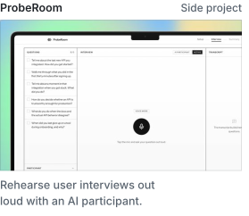
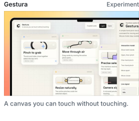
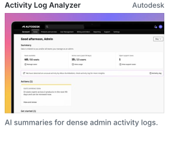
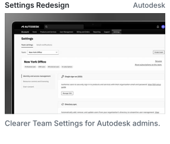
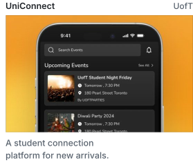

<picture>
  <source media="(prefers-color-scheme: dark)" srcset="assets/hero-dark.svg">
  <source media="(prefers-color-scheme: light)" srcset="assets/hero-light.svg">
  
</picture>

<a href="https://rishiashar.com">rishiashar.com</a>&nbsp;&nbsp;·&nbsp; <a href="https://www.linkedin.com/in/rishiashar7/">LinkedIn</a>&nbsp;&nbsp;·&nbsp; <a href="https://x.com/that_rishi07">X</a>&nbsp;&nbsp;·&nbsp; <a href="https://rishiashar.medium.com/">Medium</a>&nbsp;&nbsp;·&nbsp; <a href="mailto:rishiasharv@gmail.com">Email</a>

<!-- work:start -->

<a href="https://proberoom.vercel.app"><picture><source media="(prefers-color-scheme: dark)" srcset="assets/work-proberoom-dark.svg"></picture></a><a href="https://pinchgesture.vercel.app"><picture><source media="(prefers-color-scheme: dark)" srcset="assets/work-gestura-dark.svg"></picture></a>

<a href="https://rishiashar.com/work/intelligent-activity-log-analyzer"><picture><source media="(prefers-color-scheme: dark)" srcset="assets/work-log-analyzer-dark.svg"></picture></a><a href="https://rishiashar.com/work/settings-redesign"><picture><source media="(prefers-color-scheme: dark)" srcset="assets/work-settings-dark.svg"></picture></a><a href="https://rishiashar.com/work/uniconnect"><picture><source media="(prefers-color-scheme: dark)" srcset="assets/work-uniconnect-dark.svg"></picture></a>

<!-- work:end -->
